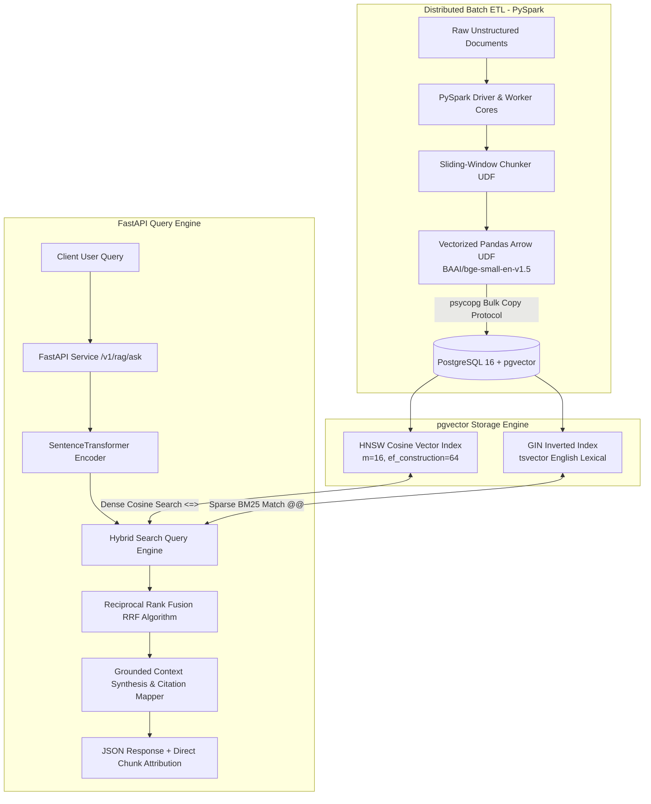

# Scalable Document ETL & Hybrid RAG Engine

[](https://github.com/shreya/spark-genai-rag/actions)
[](https://www.python.org/downloads/)
[](https://spark.apache.org/)
[](https://github.com/pgvector/pgvector)
[](https://fastapi.tiangolo.com/)

A production-grade, distributed ingestion and hybrid retrieval-augmented generation (RAG) platform. Built to demonstrate how enterprise Data Engineering infrastructures scale unstructured document pipelines using **PySpark**, **PostgreSQL (`pgvector`)**, and **FastAPI**.

Traditional RAG implementations rely on single-threaded Python scripts that bottleneck during document chunking, matrix embedding generation, and bulk database writes. This project resolves these bottlenecks by combining distributed Apache Spark worker partitions, Apache Arrow vectorized Pandas UDFs, and hybrid Reciprocal Rank Fusion (RRF).

---

## Architecture Overview



---

## Core Technical Features

* **Distributed Chunking & Arrow UDFs:** Document parsing and sliding-window segmentation run across parallel Spark partitions. Embedding computation leverages Apache Arrow memory transfers and PySpark Pandas UDFs, instantiating the neural network once per worker process rather than per record.
* **Hybrid Search (Dense + Sparse):** Overcomes semantic vector blindness to exact acronyms and IDs by combining:
  * Dense vector cosine similarity search via `pgvector` HNSW indexes.
  * Sparse keyword search via PostgreSQL native `tsvector` with inverted `GIN` indexing.
* **Reciprocal Rank Fusion (RRF):** Fuses ranking scores using constant $k=60$ to guarantee balanced precision without manual weight tuning:
  $$RRF\_Score(d) = \sum_{m \in M} \frac{1}{k + r_m(d)}$$
* **High-Throughput Partition Sink:** Bypasses slow line-by-line SQL inserts using partition-level database connections and batched write protocols.
* **Traceable Grounded Citations:** Output responses map directly to document IDs and chunk indices, preventing LLM hallucinations.

---

## Tech Stack

| Component | Technology | Role |
| :--- | :--- | :--- |
| **Distributed Engine** | Apache Spark (PySpark 3.5) | Scalable batch extraction, token chunking, and worker orchestration |
| **Vector Database** | PostgreSQL 16 + `pgvector` | Persistent storage with HNSW vector indexing and GIN full-text search |
| **Embeddings** | `BAAI/bge-small-en-v1.5` | 384-dimensional dense semantic vector representations |
| **Serving Layer** | FastAPI, Uvicorn, Pydantic V2 | Async API endpoints with lifespan state management |
| **Testing & CI** | Pytest, Docker Compose, GitHub Actions | Automated integration testing against containerized databases |

---

## Repository Structure

```text
spark-genai-rag/
├── .github/
│   └── workflows/
│       └── ci.yml                 # Automated CI: linting & containerized tests
├── docker/
│   └── docker-compose.yml         # pgvector PostgreSQL 16 service definition
├── data/
│   └── sample/                    # Sample corpus documents
├── src/
│   ├── etl/
│   │   ├── chunker.py             # Sliding-window token/word chunking logic
│   │   ├── ingest.py              # PySpark document parsing and stage loader
│   │   └── spark_session.py       # Optimized PySpark session builder
│   ├── indexing/
│   │   ├── add_fts.py             # Full-text search tsvector migration
│   │   ├── config.py              # Typed environment variables via Pydantic
│   │   ├── embedder.py            # Vectorized PySpark Pandas Arrow UDF
│   │   ├── init_db.py             # Schema migration: vector extension & HNSW index
│   │   ├── retriever.py           # Hybrid search with Reciprocal Rank Fusion
│   │   └── sink.py                # High-throughput database partition sink
│   ├── api/
│   │   ├── generator.py           # Grounded response synthesizer and citation builder
│   │   └── main.py                # FastAPI server implementation
│   └── pipeline.py                # End-to-end batch ingestion orchestrator
├── tests/
│   ├── test_api.py                # FastAPI endpoint integration tests
│   ├── test_db.py                 # Vector cosine math & database tests
│   ├── test_etl.py                # Chunker & Spark transformation unit tests
│   ├── test_pipeline.py           # End-to-end ingestion pipeline tests
│   └── test_rag.py                # Generation & citation verification tests
├── pyproject.toml                 # Package definition and dependencies
├── .env.example                   # Environment configuration template
└── README.md
```

---

## Quickstart Guide

### 1. Prerequisites
* **Operating System:** Linux, macOS, or Windows Subsystem for Linux (WSL2)
* **Python:** Version 3.10 to 3.12
* **Java:** OpenJDK 17 or higher (required for PySpark)
* **Docker:** Docker Engine with Docker Compose

### 2. Environment Setup

Clone the repository and spin up the database container:

```bash
# Clone the repository
git clone https://github.com/<YOUR_USERNAME>/spark-genai-rag.git
cd spark-genai-rag

# Start the PostgreSQL pgvector service
docker compose -f docker/docker-compose.yml up -d
```

Create a virtual environment and install the required dependencies:

```bash
python3 -m venv .venv
source .venv/bin/activate

# Upgrade pip and install CPU-optimized PyTorch
pip install --upgrade pip setuptools wheel
pip install --no-cache-dir torch --index-url https://download.pytorch.org/whl/cpu

# Install project dependencies
pip install -e .
pip install pandas pyarrow httpx
```

### 3. Initialize Database Schema & Indexes

Run the initialization scripts to activate `pgvector`, build the chunk table, and generate the HNSW and GIN search indexes:

```bash
python -m src.indexing.init_db
python -m src.indexing.add_fts
```

### 4. Run the Distributed Ingestion Pipeline

Execute the PySpark pipeline to parse text documents, generate dense embeddings in batches, and write to PostgreSQL:

```bash
python -m src.pipeline --input-dir data/sample
```

---

## Running the API Service

Start the FastAPI application with Uvicorn:

```bash
uvicorn src.api.main:app --host 0.0.0.0 --port 8000
```

The interactive OpenAPI / Swagger documentation will be available at:
`http://localhost:8000/docs`

---

## API Documentation & Example Requests

### 1. Hybrid Search Endpoint (`POST /v1/search`)

Combines HNSW vector search and GIN lexical matching with RRF ranking.

**Request:**
```bash
curl -X POST "http://localhost:8000/v1/search" \
  -H "Content-Type: application/json" \
  -d '{
    "query": "unified analytics engine for large scale data",
    "top_k": 2
  }'
```

**Response:**
```json
{
  "query": "unified analytics engine for large scale data",
  "latency_ms": 128.45,
  "total_results": 2,
  "results": [
    {
      "id": "d1330fda-bfd4-48b3-9d32-a85021a9436d",
      "document_id": "apache_spark_overview",
      "chunk_index": 0,
      "content": "Apache Spark is a unified analytics engine for large-scale data processing...",
      "rrf_score": 0.03278688524590164
    }
  ]
}
```

---

### 2. Grounded RAG Endpoint with Citations (`POST /v1/rag/ask`)

Retrieves relevant contexts, builds a constrained context boundary, and generates answers with source verification.

**Request:**
```bash
curl -X POST "http://localhost:8000/v1/rag/ask" \
  -H "Content-Type: application/json" \
  -d '{
    "query": "What APIs and high-level tools does Spark offer?",
    "top_k": 2
  }'
```

**Response:**
```json
{
  "query": "What APIs and high-level tools does Spark offer?",
  "answer": "It provides high-level APIs in Java, Scala, Python and R, and an optimized engine that supports general execution graphs. It also supports a rich set of higher-level tools including Spark SQL, MLlib, GraphX, and Structured Streaming. [Source 1: apache_spark_overview]",
  "latency_ms": 134.12,
  "citations": [
    {
      "citation_id": 1,
      "document_id": "apache_spark_overview",
      "chunk_index": 0,
      "preview": "Apache Spark is a unified analytics engine for large-scale data processing. It provides high-level APIs in Java, Scala..."
    }
  ]
}
```

---

## Automated Testing & CI Pipeline

This project includes unit and integration tests covering the Spark transformations, vector distance queries, database schemas, and FastAPI endpoints.

Run the test suite locally:

```bash
pytest -v
```

### GitHub Actions CI

Every pull request and push to `main` executes `.github/workflows/ci.yml`, which:
1. Provisions an ephemeral `pgvector/pgvector:pg16` container.
2. Sets up Python 3.12 and OpenJDK 17.
3. Runs `ruff` for linting and style enforcement.
4. Executes the database migrations and runs all 9 `pytest` test suites.

---

## License

This project is licensed under the MIT License - see the LICENSE file for details.